<div align="center">

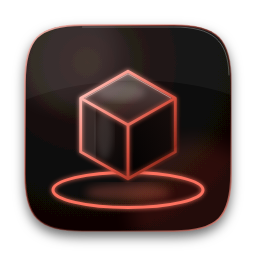

# Flatform

**Turn a photo into a 3D model, drop it into any scene, and render it.**

[](https://github.com/TyroneMadison/Flatform/releases/latest)
[-FF7A66?style=for-the-badge&logo=apple&logoColor=white)](https://github.com/TyroneMadison/Flatform/releases/latest)
[-E2523E?style=for-the-badge&logo=apple&logoColor=white)](https://github.com/TyroneMadison/Flatform/releases/latest)

<sub>All versions are on the <a href="https://github.com/TyroneMadison/Flatform/releases">Releases page</a>.</sub>

<br>

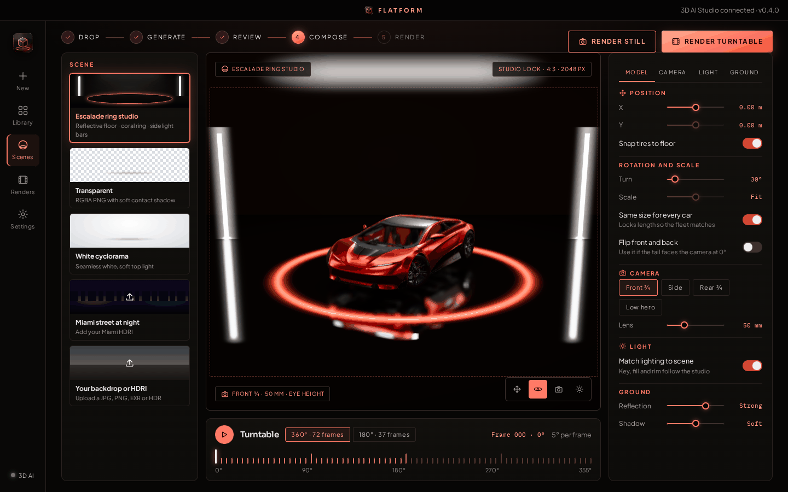

</div>

## How it works

### 1. Drop in a photo

Drag a picture of a car into the window. One good photo works. Four photos (front, left, back and right) work even better.

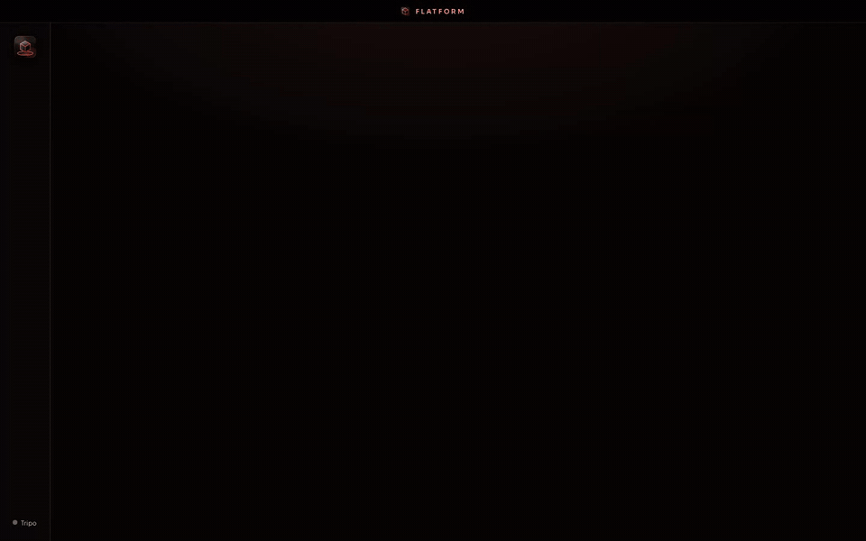

### 2. Pick a look

Choose a preset: **Draft**, **Balanced** or **Max quality**. You see the price before you start. Want more control? Open a group and move the sliders.

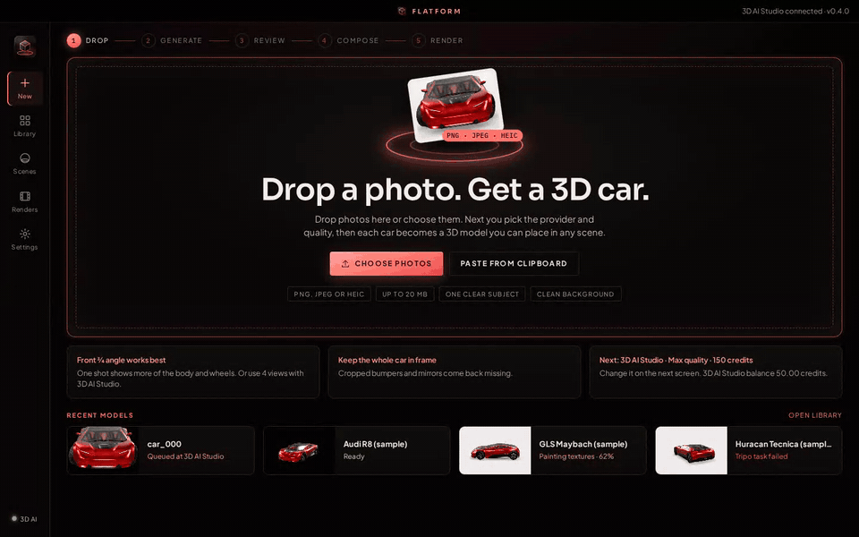

### 3. Wait a minute or two

Flatform sends your photo to the 3D service and saves the model on your computer as soon as it's ready.

### 4. Set the scene

Put the car on a glowing studio stage, a clean white backdrop, a see-through background, or your own picture. Turn it, light it, and frame the shot.

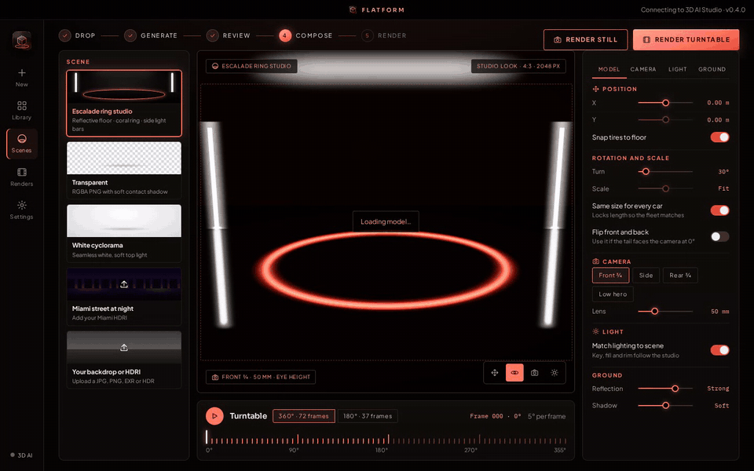

### 5. Render it

Make still pictures, a full 360° spin, or a 180° half turn. Flatform puts every file in one neat folder, ready for your website.

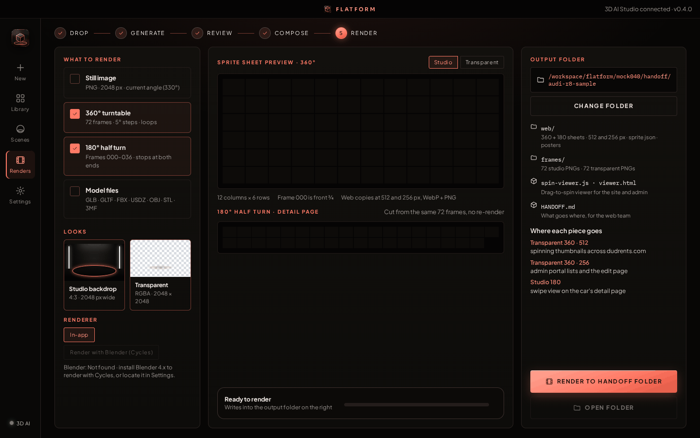

## What it can do

- 📸 Make a 3D model from **one photo or four**
- ⚡ **Presets** with the price shown up front, plus sliders when you want them
- 🔀 Use **Tripo** or **3D AI Studio**, and switch any time
- 🎬 Studio scenes, your own backgrounds, and see-through renders
- 🔁 360° and 180° spins, stills, and sprite sheets for the web
- 📚 A **library** of every model you've made, with search
- 🔒 Your keys stay **encrypted on your computer**
- 🔔 Tells you when a **new version** is out

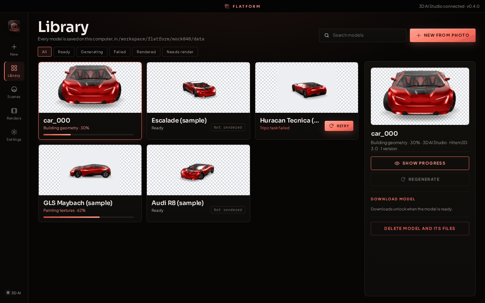

## What you need

You need a key from **one** of these services. A key is like a password that lets Flatform use your account. You pay the service for each model; Flatform adds no fees.

- **Tripo:** get a key at [developers.tripo3d.ai](https://developers.tripo3d.ai)
- **3D AI Studio:** get a key from the [3D AI Studio API dashboard](https://www.3daistudio.com/Platform/API)

**To add your key:**

1. Open Flatform and click **Settings** in the left bar.
2. Click **Providers**.
3. Find your service and click **Replace**.
4. Paste your key and save it.
5. Click **Test**. A green check and your credit balance mean it worked. Testing is free.

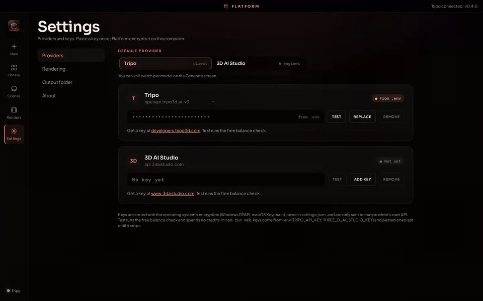

## The first time you open it

Flatform isn't signed by Apple or Microsoft yet, so your computer may show a warning the first time.

- **Windows:** click **More info**, then **Run anyway**.
- **Mac:** open the app once, then go to **System Settings → Privacy & Security** and click **Open Anyway**.

You only have to do this once.

## More screenshots

| Drop | Four views |
|---|---|
| 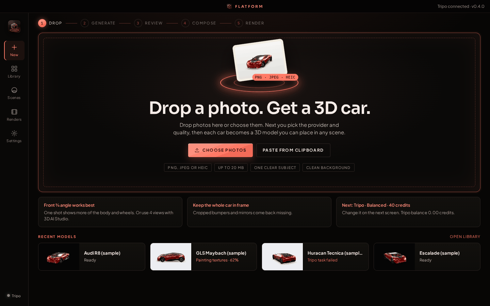 | 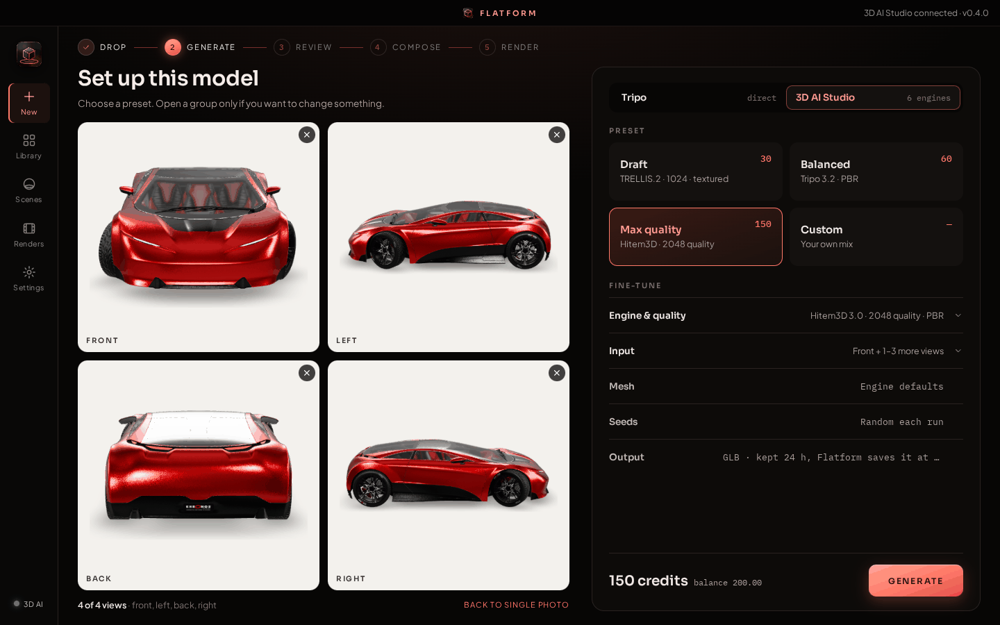 |
| **Sliders** | **Settings** |
| 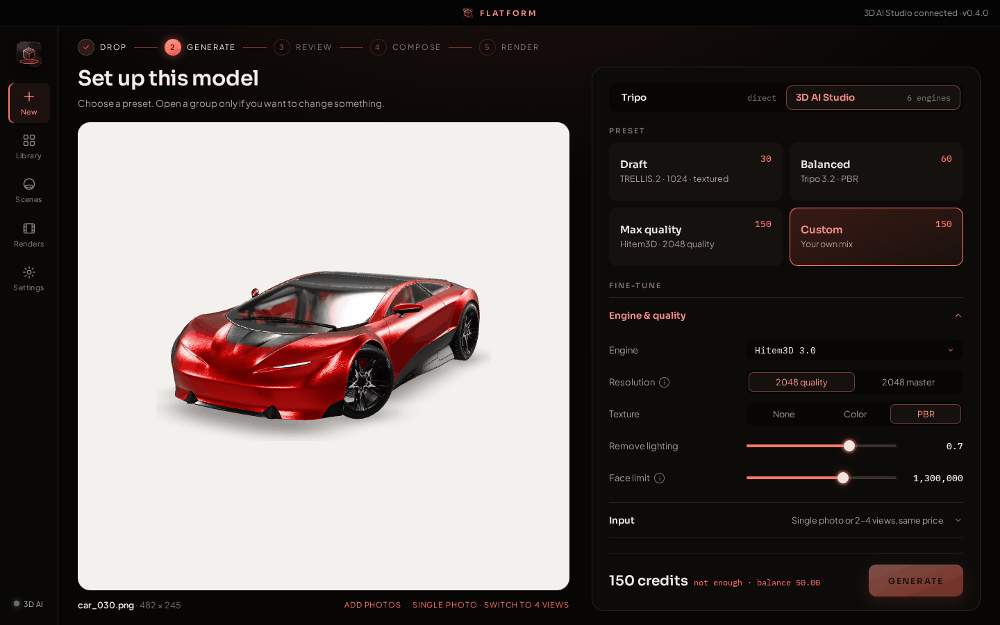 | 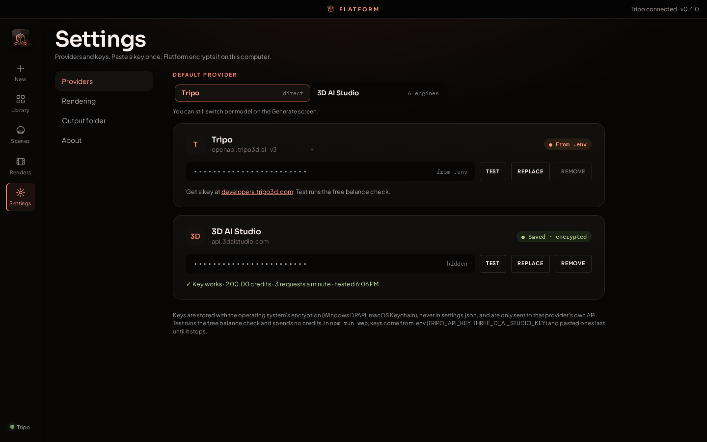 |

<sub>Flatform is not made by or connected to Tripo, VAST or 3D AI Studio.</sub>

<details>
<summary><b>For developers</b></summary>

### How it works inside

- `main.mjs` (Electron) starts the app server on a random port on 127.0.0.1 and shows it in a window. `preload.cjs` gives the page four checked helpers (pick a folder, pick a file, show an item in its folder, open a folder); the page has no Node access.
- `server.mjs` takes the photos and setup from the page, checks the setup against the engine catalogue, and submits the job. Tripo: it uploads the photo (`POST /v3/files`), starts `image-to-model` and polls the task when the page asks; when a task succeeds it downloads the GLB and preview right away, because Tripo's result URLs expire after 5 minutes. Exports call `POST /v3/models/convert`. 3D AI Studio: photos go as base64, jobs are polled while staying under its 3-requests-a-minute limit, and results are saved right away because its links expire after 24 hours; the client and the limiter are in `providers.mjs`.
- `keys.mjs` is the per-provider key store (and the v0.3 key move); `public/lib/engines.js` is the catalogue of providers, engines, options, presets and request bodies, shared by the page, the server and the tests; `public/lib/pricing.js` has the prices.
- The server only answers requests addressed to its own host, refuses any state-changing request from another origin, and serves the page with a strict Content-Security-Policy. Library and settings writes are atomic.
- The front end is plain ES modules (`public/app.js`, `public/views/*.js`, `public/lib/*.js`, `public/styles/*.css`), no build step. `public/lib/pipeline.js` holds the turntable and handoff rules shared by the app, the server and the tests.
- three.js is served from local files: `three/build` from inside the app, and the addons (`three/examples/jsm`: loaders, controls, Draco/Meshopt decoders) as an extra resource next to it, because electron-builder leaves every dependency's `examples/` folder out of the package. `render/blender_turntable.py` ships the same way so Blender can read it.
- `updates.mjs` looks for a newer version a few seconds after start and every 6 hours (unless turned off in Settings → About): one unauthenticated `GET https://api.github.com/repos/TyroneMadison/Flatform/releases/latest` from the server, drafts and prereleases ignored, failures silent. The page reads `GET /api/update` and shows a banner. Download opens this computer's installer (or the release page) in the browser, and only `https://github.com/TyroneMadison/Flatform/…` links are ever opened. Nothing is downloaded or installed on its own.
- For screenshots, point `FLATFORM_UPDATE_URL` at a fake release served from 127.0.0.1 (plain http is only accepted there) and set `FLATFORM_UPDATE_DELAY_MS=0` to check right away.
- The library lives in the app's data folder: `%APPDATA%\Flatform\library` on Windows, `~/Library/Application Support/Flatform/library` on Mac. Libraries from earlier versions are upgraded in place on first launch (each old model becomes version 1, and every older version is marked as made with Tripo).

Fonts: Sora, Plus Jakarta Sans and IBM Plex Mono are bundled in `public/fonts` under the SIL Open Font License (texts included). Nothing is loaded from the internet except the two providers' APIs and their result files, and GitHub's latest-release info for the update check. See `THIRD_PARTY_NOTICES.md` for every third-party component.

### Build and test

```bash
npm install
npm run app      # desktop app
npm test         # server, providers, pricing, pipeline and update tests against a fake Tripo, 3D AI Studio, GitHub and Blender; no credits, no network
npm run dist     # build the installer for this OS into dist/
```

`npm run web` runs it as a local website instead. Put `TRIPO_API_KEY` and/or `THREE_D_AI_STUDIO_KEY` in `.env` (see `.env.example`), then open http://localhost:5173. In this mode folder pickers become text fields, and keys pasted in Settings last until the server stops.

Flatform Test: double-click `Launch-Flatform-Test.cmd` (or run `electron . --flatform-test`). It is a separate app
(name Flatform Test, its own app id, data in `test-app/data`, update checks off) with mock Tripo, 3D AI Studio and
Blender, seeded with sample models, photos and every room, and a Test screen with the v3 checklist. Delete
`test-app/data` to start it fresh. `test-app/make-samples.py` rebuilds its samples with a
real Blender; `npx electron test-app/make-env-thumbs.mjs` re-renders the scene thumbnails in the app's own renderer.

Releases: push a tag like `v0.4.0`. GitHub Actions builds Windows and Mac and attaches them to a draft release.

</details>

## License

MIT
